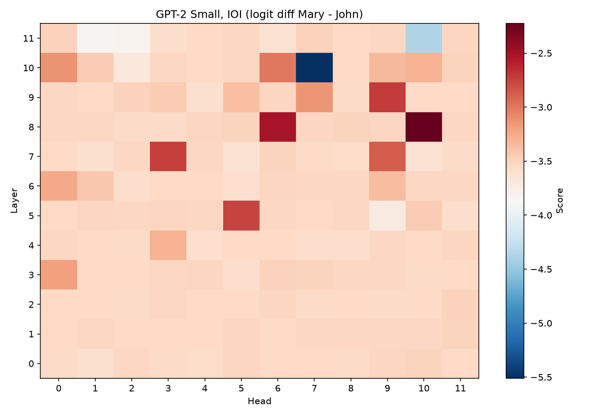

# interp-patch-kit

A lightweight tool for running activation patching sweeps on transformer language models, built on
TransformerLens.

## Why

Activation patching means testing each layer and attention head one at a time, which is slow and
repetitive to do by hand. This tool runs the whole sweep for you, so you can focus on interpreting
the results instead of writing patching loops.



## Install

```bash
pip install git+https://github.com/Agentscreator/interp-patch-kit.git
```

## Usage

```python
from interp_patch_kit import load_model, patch_sweep, plot_heatmap

model = load_model("gpt2")

clean = "When John and Mary went to the store, John gave a drink to"
corrupted = "When John and Mary went to the store, Mary gave a drink to"

mary, john = model.to_single_token(" Mary"), model.to_single_token(" John")
score = lambda logits: (logits[0, -1, mary] - logits[0, -1, john]).item()

grid = patch_sweep(model, clean, corrupted, model.cfg.n_layers, model.cfg.n_heads, score)
plot_heatmap(grid, save_path="heatmap.png")  # also prints and returns the best (layer, head)
```

The clean and corrupted prompts must tokenize to the same length. By default each attention head's
output is patched; pass `hook="attn_out"`, `"mlp_out"`, `"resid_pre"` or `"resid_post"` to patch a
whole layer instead.

## Credits

Built with [TransformerLens](https://github.com/TransformerLensOrg/TransformerLens). Made for working
through [ARENA](https://www.arena.education/)-style mechanistic interpretability challenges.
